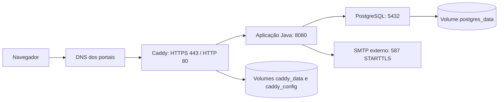

# vendaFacil — sistema e infraestrutura no Ubuntu Server 26

**Referência:** código da versão `0.2.0-SNAPSHOT`, atualizado em 19/10/2026.

**Sistema operacional deste procedimento:** Ubuntu Server **26.04 LTS**, 64 bits.

**Topologia:** um servidor, Docker Engine, Docker Compose, Caddy e PostgreSQL.

Este documento descreve o que está implementado, como instalar a infraestrutura, publicar os portais com HTTPS e manter os dados. Os comandos Linux são para **Bash no servidor Ubuntu**, salvo os blocos identificados como PowerShell.

O projeto entrega a fundação de acesso, catálogo, preços e estoque de um PDV multiempresa e multifilial. **Vendas, caixa e emissão fiscal ainda não estão implementados.** Colocar os containers no servidor não transforma esta entrega na V1 comercial completa.

O procedimento foi preparado a partir dos arquivos do repositório e de documentação oficial. **A instalação em um Ubuntu Server 26.04 real, com domínio e SMTP de produção, ainda precisa ser executada e homologada.** Os exemplos de domínio, IP e e-mail devem ser substituídos pelos seus dados.

## Sumário

1. [Visão do sistema](#1-visão-do-sistema)
2. [Funcionalidades disponíveis e pendentes](#2-funcionalidades-disponíveis-e-pendentes)
3. [Arquitetura, tecnologias e dados](#3-arquitetura-tecnologias-e-dados)
4. [Autenticação, autorização e recuperação](#4-autenticação-autorização-e-recuperação)
5. [Infraestrutura proposta](#5-infraestrutura-proposta)
6. [Preparar o Ubuntu](#6-preparar-o-ubuntu)
7. [Instalar Docker Engine e Compose](#7-instalar-docker-engine-e-compose)
8. [Enviar o projeto ao servidor](#8-enviar-o-projeto-ao-servidor)
9. [Configurar domínio e DNS](#9-configurar-domínio-e-dns)
10. [Configurar produção e SMTP](#10-configurar-produção-e-smtp)
11. [Configurar Caddy e HTTPS](#11-configurar-caddy-e-https)
12. [Subir a infraestrutura e criar o administrador](#12-subir-a-infraestrutura-e-criar-o-administrador)
13. [Cadastrar empresas, filiais e usuários](#13-cadastrar-empresas-filiais-e-usuários)
14. [Operação, logs e monitoramento](#14-operação-logs-e-monitoramento)
15. [Backup automatizado](#15-backup-automatizado)
16. [Testar restauração e recuperar o ambiente](#16-testar-restauração-e-recuperar-o-ambiente)
17. [Atualizações e retorno de versão](#17-atualizações-e-retorno-de-versão)
18. [Ambiente local, desenvolvimento e testes](#18-ambiente-local-desenvolvimento-e-testes)
19. [Solução de problemas](#19-solução-de-problemas)
20. [Checklist de entrega e limites atuais](#20-checklist-de-entrega-e-limites-atuais)
21. [Referências](#21-referências)

## 1. Visão do sistema

O vendaFacil é uma aplicação web em que cada empresa acessa um portal próprio por subdomínio e pode possuir várias filiais. A administração da plataforma utiliza um portal separado.

Exemplo de endereçamento, considerando um domínio que você controle:

| Endereço                                | Finalidade                              |
| --------------------------------------- | --------------------------------------- |
| `https://admin.seu-dominio.com.br`      | Administração SaaS da plataforma        |
| `https://minha-loja.seu-dominio.com.br` | Portal da empresa com slug `minha-loja` |
| `https://outra-loja.seu-dominio.com.br` | Portal de outra empresa                 |

O domínio-base sem subdomínio e o acesso direto pelo IP não são portais da aplicação. O subdomínio identifica o contexto; não existe escolha livre de empresa por parâmetro de formulário.

### 1.1. Empresa, filial e identidade

- **Empresa / tenant:** fronteira de dados e permissões. Possui slug único, nome e situação ativa ou suspensa.
- **Filial / store:** unidade de uma empresa, com nome, cidade, UF e situação ativa/inativa.
- **Usuário:** identidade global identificada por e-mail único, com uma senha e situação global.
- **Vínculo / membership:** associação de um usuário a uma empresa.
- **Concessão de perfil / grant:** liga o vínculo a uma filial e a um perfil, com ativação própria.

Uma pessoa pode ter vínculos em empresas diferentes e receber permissões distintas em cada filial. A senha pertence à identidade global; as autorizações pertencem aos vínculos e concessões.

### 1.2. Quem administra o quê

| Ator                            | Responsabilidade implementada                                                 |
| ------------------------------- | ----------------------------------------------------------------------------- |
| Super Admin da plataforma       | Gerir empresas e identidades globais pelo portal `admin`                      |
| Administrador da empresa/filial | Gerir equipe, concessões e filiais dentro das autorizações que possui         |
| Demais usuários                 | Entrar no portal e acessar as filiais e funcionalidades liberadas pelo perfil |

O botão **Abrir portal** no card da empresa abre seu endereço em outra aba. O usuário entra normalmente com uma conta autorizada nessa empresa. O Super Admin não recebe acesso operacional automático aos clientes e não há impersonação.

## 2. Funcionalidades disponíveis e pendentes

### 2.1. Entregue nesta versão

| Área              | Comportamento disponível                                                                                                 |
| ----------------- | ------------------------------------------------------------------------------------------------------------------------ |
| Acesso            | Login, logout, sessão por host e seleção/troca de filial autorizada                                                      |
| Recuperação       | Solicitação por e-mail e redefinição de senha nos portais de empresa e da plataforma                                     |
| Painel SaaS       | Criação de empresa com Matriz e administrador inicial; alteração do nome; ativação e suspensão                           |
| Cards de empresas | Contadores de filiais e membros ativos, acesso ao portal e à gestão de usuários filtrada                                 |
| Usuários SaaS     | Pesquisa, filtro por empresa, paginação de 20 contas, edição de nome, bloqueio/restauração global e envio de recuperação |
| Equipe da filial  | Criação de acesso, busca, atribuição de perfil, bloqueio/restauração da concessão e recuperação por e-mail               |
| Filiais           | Criação, edição, ativação e desativação, respeitando o acesso do administrador                                           |
| Exportação        | CSV de filiais autorizadas, com proteção contra fórmulas de planilha                                                     |
| Auditoria         | Registro de eventos com contexto e proteção contra UPDATE/DELETE por trigger                                             |
| Interface         | Layout responsivo, ajuda por teclado/toque e tema em roxo e off-white                                                    |
| Infraestrutura    | Compose local e de produção, migrations Flyway, logs estruturados e endpoint de saúde                                    |

### 2.2. Próximas entregas

A Etapa 2 acrescentou produtos/categorias, preços por filial com histórico, estoque/movimentos/mínimo por filial, imagens privadas PNG/JPEG e importação CSV/XLSX com prévia, relatório e confirmação integral. Consulte o [manual de catálogo e estoque](docs/runbooks/catalog-and-stock.md) para operar esses módulos. Imagens e dados de importação ficam no PostgreSQL e já participam do backup lógico descrito neste guia; não há volume adicional de uploads.

Ainda não há PDV, vendas, caixa, cálculo de descontos comerciais, cancelamentos/devoluções, relatórios de vendas, recibos ou emissão de NF-e/NFC-e.

Também estão pendentes convites com verificação de e-mail, alteração verificada de e-mail, edição das definições dos perfis, MFA, upload de logotipo, habilitação de módulos, cobrança recorrente da plataforma e ampliação de paginação nas demais telas.

Existem permissões e políticas de desconto no banco para os módulos futuros. Isso **não significa que os respectivos fluxos de venda, aprovação ou fiscal já funcionem**.

O andamento detalhado está em [docs/implementation-status.md](docs/implementation-status.md), e o escopo original está em [SDD-VendaFacilKs.md](SDD-VendaFacilKs.md).

## 3. Arquitetura, tecnologias e dados

### 3.1. Tecnologias do repositório

| Componente             | Versão/configuração de referência | Uso                                                  |
| ---------------------- | --------------------------------- | ---------------------------------------------------- |
| Java                   | 25 LTS, Eclipse Temurin           | Build e execução da aplicação                        |
| Spring Boot            | 4.0.8                             | Servidor web, configuração, segurança e persistência |
| Spring MVC + Thymeleaf | Gerenciados pelo Spring Boot      | Páginas renderizadas no servidor                     |
| Spring Security        | Gerenciado pelo Spring Boot       | Sessão, CSRF, autenticação e autorização             |
| PostgreSQL             | Imagem `postgres:17.11-alpine`    | Banco relacional compartilhado                       |
| Flyway                 | Gerenciado pelo Spring Boot       | Evolução versionada do schema                        |
| Bootstrap              | 5.3.8                             | Interface com assets locais                          |
| Bootstrap Icons        | 1.13.1                            | Ícones locais                                        |
| JavaScript             | Sem framework de frontend         | Interações no navegador                              |
| Caddy                  | Imagem `caddy:2.10.2-alpine`      | Proxy reverso e certificados HTTPS                   |
| Mailpit                | Imagem `axllent/mailpit:v1.31.6`  | Caixa de e-mails exclusivamente local                |
| Maven                  | Wrapper com Maven 3.9.11          | Build, testes e verificações Java                    |
| Node.js                | 24 no CI                          | Ferramentas de qualidade e sincronização de assets   |

Essas são as versões fixadas no projeto, e não uma afirmação de que sejam as versões mais recentes. Atualizações devem passar pelas verificações da aplicação.

Com Docker, o servidor **não precisa instalar Java, Maven, Node.js, PostgreSQL ou Caddy diretamente no host**. O Dockerfile compila em um estágio com JDK e executa o JAR em outro, com JRE e usuário sem privilégios de root.

### 3.2. Organização do código

```text
src/main/java/br/com/vendafacil/
  administration/       gestão SaaS e provisionamento de empresas
  catalog/              categorias, produtos, preços e imagens
    importing/          prévia e confirmação de CSV/XLSX
  identity/             identidades, vínculos, perfis e concessões
    recovery/           tokens e envio de recuperação de senha
  store/                filiais e seleção de unidade
  inventory/            saldos, movimentos, mínimos e aprovação de exceções
  tenant/               empresas, contexto e resolução de host
  shared/
    audit/              auditoria
    config/             configurações, páginas e bootstrap
    exception/          tratamento de erros
    security/           filtros, autenticação, sessão e políticas

src/main/resources/
  db/migration/         migrations SQL
  static/               CSS, JavaScript, fontes e assets locais
  templates/            páginas Thymeleaf
  application*.yml      configuração comum e por profile

infra/Caddyfile                       hosts públicos e proxy
docker-compose.yml                    ambiente local com Mailpit
docker-compose.production.yml         produção, independente do local
Dockerfile                            build e imagem da aplicação
tooling/                              qualidade e validação de commits
docs/                                 arquitetura, decisões e runbooks
```

Controllers delegam regras a serviços; serviços e repositórios aplicam o contexto de empresa e filial. A aplicação é um monólito modular, executado em um processo Java nesta topologia.

### 3.3. Modelo de dados atual

| Tabela                                            | Conteúdo                                                          |
| ------------------------------------------------- | ----------------------------------------------------------------- |
| `tenants`                                         | Empresas, slug, nome e situação                                   |
| `stores`                                          | Filiais associadas à empresa                                      |
| `users`                                           | Identidade global, hash de senha, ativação e versão da credencial |
| `memberships`                                     | Vínculo entre identidade e empresa                                |
| `permissions`                                     | Catálogo de permissões                                            |
| `roles`                                           | Perfis por empresa e limite de desconto cadastrado                |
| `role_permissions`                                | Permissões de cada perfil                                         |
| `membership_store_roles`                          | Concessões de perfil por filial e sua ativação                    |
| `tenant_policies`                                 | Políticas iniciais para os próximos módulos                       |
| `categories`, `products`                          | Categorias e catálogo compartilhado pela empresa                  |
| `product_images`                                  | Imagens PNG normalizadas e privadas                               |
| `store_prices`, `store_price_history`             | Preço da filial e histórico imutável                              |
| `stock_balances`, `stock_movements`               | Saldo/mínimo por filial e livro de movimentações                  |
| `import_jobs`, `import_rows`, `import_row_errors` | Prévias de importação, dados e erros por linha                    |
| `password_reset_tokens`                           | Hash do token, escopo, validade e utilização                      |
| `audit_logs`                                      | Eventos de auditoria                                              |
| `flyway_schema_history`                           | Histórico técnico de migrations                                   |

As migrations atuais são V1, V2 e V3. A V3 inclui categorias, produtos, imagens, preços/histórico, saldos, movimentos, lotes de importação, linhas e erros, com referências compostas por tenant/filial. O Hibernate valida o schema; não é usado `ddl-auto=update`. Migrations aplicadas não devem ser reescritas: alterações de banco devem entrar em nova migration.

O isolamento usa filtros de aplicação, autorização nos serviços e FKs compostas. **PostgreSQL Row Level Security não está implementado.** A trigger de auditoria impede alterações usuais de linhas, mas não substitui segregação de privilégios ou proteção contra um administrador do banco.

## 4. Autenticação, autorização e recuperação

### 4.1. Entrada e sessão

1. O sistema valida o Host recebido e resolve o portal da plataforma ou uma empresa existente.
2. O login verifica a identidade, sua situação e o vínculo com o portal.
3. O sistema oferece somente as filiais ativas autorizadas.
4. A filial escolhida fica na sessão como preferência; as permissões são revalidadas em cada acesso.

A suspensão da empresa, bloqueio da identidade ou revogação de acesso passa a impedir novas requisições autenticadas. A sessão de uma empresa não pode ser reaproveitada em outra.

O cookie chama-se `VFSESSION`, é HttpOnly, SameSite=Lax e limitado ao host. Em produção, também é Secure. Há proteção CSRF nos formulários e requisições de alteração. O timeout de inatividade é de 30 minutos.

As senhas usam BCrypt com custo 12. A política atual aceita de 12 a 64 caracteres, com limite adicional de 72 bytes em UTF-8. O login tem limitação de falhas por contexto/IP: 10 falhas em uma janela de 15 minutos.

As sessões e os limitadores ficam na memória da instância. Reiniciar a aplicação encerra as sessões; executar várias réplicas exige implementar sessão compartilhada e limitação distribuída.

### 4.2. Perfis iniciais

| Perfil            | Configuração inicial                                                                                   |
| ----------------- | ------------------------------------------------------------------------------------------------------ |
| Administrador     | Todas as permissões catalogadas; limite cadastrado de desconto de 20%                                  |
| Gerente           | Permissões exceto gestão de usuários e configuração fiscal; limite de 10%                              |
| Operador de caixa | Permissões iniciais de leitura de produtos, venda e abertura/fechamento de caixa; limite de 0%         |
| Estoquista        | Permissões iniciais de leitura/edição/importação de produtos e leitura/ajuste de estoque; limite de 0% |

Os limites e permissões comerciais são preparação do modelo. Somente os módulos já implementados podem ser usados.

Na gestão de equipe, o administrador não pode conceder permissões ou limite acima do seu próprio acesso, nem alterar a própria concessão. Alterações nessa tela valem para a filial ativa. O bloqueio global no painel SaaS afeta todos os portais da identidade.

### 4.3. Recuperação de senha

1. A pessoa abre **Esqueci minha senha** no portal correto, inclusive no `admin`.
2. Informa o e-mail cadastrado; a página responde de forma genérica.
3. Se houver identidade elegível nesse contexto, o sistema envia o link ao endereço cadastrado.
4. O link é válido por 30 minutos, funciona uma única vez e pertence ao portal solicitado.
5. A pessoa define e confirma a nova senha e entra normalmente pelo login.

Um novo pedido invalida o token anterior. A alteração incrementa a versão da credencial e invalida as sessões antigas. A nova senha vale em todos os portais da identidade global; a recuperação não reativa uma conta ou acesso bloqueado.

O token é aleatório e somente seu hash SHA-256 fica no banco. Os links são construídos com o domínio/protocolo configurado, sem confiar no Host informado por um solicitante. Páginas de redefinição usam restrições de cache e de referência.

O envio é assíncrono, com fila limitada em memória. **Não existe fila persistente de e-mails nem retentativa automática de entrega.** Em falha SMTP ou reinício durante o processamento, corrija o problema e solicite um novo link. O usuário também recebe uma notificação de alteração de senha, sem a senha no conteúdo.

## 5. Infraestrutura proposta

### 5.1. Topologia



O Compose de produção cria a rede `172.28.56.0/24` e reserva `172.28.56.10` ao proxy. O Tomcat confia nesse IP para interpretar o protocolo encaminhado. Verifique antes se essa faixa não conflita com sua rede, VPN ou outras redes Docker.

### 5.2. Dimensionamento inicial

Para uma homologação ou piloto pequeno, um ponto de partida é **2 vCPUs, 4 GB de RAM e 60 GB de SSD**. Fazer o build no mesmo servidor pode exigir mais memória; 8 GB dão margem maior. Essas medidas são estimativas de planejamento, não um benchmark de capacidade ou SLA.

Reserve espaço adicional para imagens, cache de build, crescimento do banco e backups. O Compose atual não fixa limites de CPU/memória; a JVM usa `MaxRAMPercentage=75`, portanto é necessário dimensionar e limitar recursos antes de aumentar a carga. Não há alta disponibilidade nessa topologia: servidor ou disco indisponível afeta todos os portais.

### 5.3. Portas

| Porta                               | Origem                         | Finalidade                                        |
| ----------------------------------- | ------------------------------ | ------------------------------------------------- |
| SSH configurada, normalmente 22/TCP | IPs de administração           | Gestão do Ubuntu                                  |
| 80/TCP                              | Internet                       | Redirecionamento HTTPS e validação de certificado |
| 443/TCP                             | Internet                       | Portais HTTPS                                     |
| 443/UDP                             | Internet, opcional para HTTP/3 | Publicada pelo Caddy                              |
| 8080/TCP                            | Somente rede Docker            | Aplicação, sem publicação no host                 |
| 5432/TCP                            | Somente rede Docker            | Banco, sem publicação no host                     |

O servidor também precisa de saída para DNS, repositórios Ubuntu/Docker/Maven, registro de imagens, autoridades de certificado e o SMTP contratado. Mailpit e suas portas não fazem parte da produção.

### 5.4. Persistência e nome do projeto

| Volume lógico   | Conteúdo                                         | Nome esperado usando este guia |
| --------------- | ------------------------------------------------ | ------------------------------ |
| `postgres_data` | Cluster PostgreSQL em `/var/lib/postgresql/data` | `vendafacil_postgres_data`     |
| `caddy_data`    | Certificados, chaves e estado de emissão         | `vendafacil_caddy_data`        |
| `caddy_config`  | Estado persistente do Caddy                      | `vendafacil_caddy_config`      |

Todos os comandos de produção usam o nome fixo de projeto **`vendafacil`**. Mudar esse nome pode criar outros volumes e fazer parecer que os dados desapareceram. Identifique os volumes existentes antes de adotar este nome em uma instalação que já tenha dados.

`docker compose down` preserva volumes nomeados. **Não use `down -v`, `docker volume prune` ou limpeza de volumes na operação deste ambiente.** Snapshot de VM ou cópia de um diretório PostgreSQL em uso não substitui o backup lógico e o teste de restauração descritos adiante.

## 6. Preparar o Ubuntu

### 6.1. Versão e acesso

Este guia considera uma VM/servidor dedicado novo com **Ubuntu Server 26.04 LTS**. A linha 26.04 consta na matriz oficial do Docker e no ciclo LTS do Ubuntu. [Ubuntu: ciclo de versões](https://ubuntu.com/about/release-cycle), [Docker Engine no Ubuntu](https://docs.docker.com/engine/install/ubuntu/).

Conecte-se com uma conta administrativa que possua `sudo`. Antes de alterar SSH ou firewall, confirme que a chave SSH funciona em uma segunda sessão e que você possui acesso ao console de recuperação do provedor.

```bash
cat /etc/os-release
uname -m
free -h
df -h
ip route
timedatectl status
sudo -v
```

Para seguir exatamente o procedimento, confirme `VERSION_ID="26.04"`. Os exemplos de imagens consideram uma arquitetura suportada pelas respectivas imagens; o alvo de referência é `x86_64`/amd64.

### 6.2. Atualização e utilitários

```bash
sudo apt update
sudo apt upgrade
sudo apt install ca-certificates curl git openssl ufw dnsutils nano unzip util-linux
```

Se `/var/run/reboot-required` existir, programe a reinicialização e reconecte antes de continuar. Mantenha o relógio sincronizado: validade de certificados, tokens e registros de auditoria dependem de horário correto. O banco e o Hibernate trabalham com timestamps em UTC.

### 6.3. Firewall

Confira a porta real do SSH. Para a porta padrão 22 e o serviço OpenSSH:

```bash
sudo ufw default deny incoming
sudo ufw default allow outgoing
sudo ufw allow OpenSSH
sudo ufw allow 80/tcp
sudo ufw allow 443/tcp
sudo ufw allow 443/udp
sudo ufw enable
sudo ufw status verbose
```

Se o SSH usar outra porta, libere essa porta antes de ativar o UFW. No firewall do provedor, libere 80/443 e restrinja SSH às origens de administração. Não crie regras públicas para 5432, 8080, 8025 ou 1025. [Ubuntu: firewall UFW](https://ubuntu.com/server/docs/how-to/security/firewalls/).

O Docker pode encaminhar portas publicadas por caminhos que contornam regras comuns do UFW. Por isso a proteção principal deste projeto inclui **não publicar o banco e a aplicação**. Preserve essa configuração e confira também o firewall do provedor. [Docker: filtragem de pacotes e firewalls](https://docs.docker.com/engine/network/packet-filtering-firewalls/).

## 7. Instalar Docker Engine e Compose

No servidor usamos Docker Engine com o plugin `docker compose`; Docker Desktop não é necessário.

Em uma máquina já utilizada, verifique a existência de `docker.io`, Compose antigo, `podman-docker`, `containerd` ou `runc` de outra instalação antes de trocar os pacotes. A remoção desses componentes precisa considerar os serviços existentes. Os comandos abaixo pressupõem o servidor novo descrito na seção 6.

### 7.1. Repositório oficial

```bash
sudo install -d -m 0755 /etc/apt/keyrings
sudo curl -fsSL https://download.docker.com/linux/ubuntu/gpg \
  -o /etc/apt/keyrings/docker.asc
sudo chmod a+r /etc/apt/keyrings/docker.asc

ubuntu_suite="$(. /etc/os-release && printf '%s' "$VERSION_CODENAME")"
docker_arch="$(dpkg --print-architecture)"

sudo tee /etc/apt/sources.list.d/docker.sources >/dev/null <<EOF
Types: deb
URIs: https://download.docker.com/linux/ubuntu
Suites: $ubuntu_suite
Components: stable
Architectures: $docker_arch
Signed-By: /etc/apt/keyrings/docker.asc
EOF

sudo apt update
sudo apt install docker-ce docker-ce-cli containerd.io docker-buildx-plugin docker-compose-plugin
sudo systemctl enable --now docker.service containerd.service
```

Este procedimento usa o repositório APT oficial. Para alterações futuras nos pacotes suportados, consulte a [instalação oficial no Ubuntu](https://docs.docker.com/engine/install/ubuntu/).

### 7.2. Conferência

```bash
sudo docker version
sudo docker compose version
sudo docker run --rm hello-world
sudo systemctl is-active docker
sudo docker network ls
```

Anote as versões instaladas no registro de implantação. O guia usa `sudo docker`, sem exigir associação ao grupo `docker`; esse grupo concede poderes equivalentes aos de root. [Docker: pós-instalação no Linux](https://docs.docker.com/engine/install/linux-postinstall/).

## 8. Enviar o projeto ao servidor

Use **uma** das alternativas abaixo. Não transfira `.env` local, volumes do banco, `.tools`, `.local` ou `node_modules`.

### 8.1. Alternativa A — repositório Git acessível

Se o projeto já estiver em um remoto autorizado, execute no Ubuntu, substituindo a URL:

```bash
sudo install -d -m 0750 -o "$(id -un)" -g "$(id -gn)" /opt/vendafacil
git clone URL_REAL_DO_REPOSITORIO /opt/vendafacil
cd /opt/vendafacil
git rev-parse HEAD
```

Não coloque token de acesso na URL ou no histórico do shell. A autorização para criar commits locais não implica publicar o projeto em um remoto.

### 8.2. Alternativa B — arquivo do commit local

Se o projeto ainda só estiver neste computador, gere um pacote do commit desejado. No **PowerShell do Windows**, dentro do repositório:

```powershell
git rev-parse HEAD
git archive --format=tar.gz --output=vendafacil-release.tar.gz HEAD
Get-FileHash .\vendafacil-release.tar.gz -Algorithm SHA256
scp .\vendafacil-release.tar.gz usuario@IP_REAL_DO_SERVIDOR:/tmp/vendafacil-release.tar.gz
```

Use o executável Git instalado na sua máquina. Caso esteja usando o Git portátil desta implementação, substitua `git` por `& .\.tools\git\cmd\git.exe`. O pacote inclui somente arquivos versionados naquele commit. Gere-o depois de commitar as alterações que deseja instalar e guarde o hash do commit junto da release; o `.tar.gz` gerado não deve entrar em outro commit.

No **Ubuntu**, compare o SHA-256 com o resultado do Windows e extraia:

```bash
sha256sum /tmp/vendafacil-release.tar.gz
tar -tzf /tmp/vendafacil-release.tar.gz | head -40
sudo install -d -m 0750 -o "$(id -un)" -g "$(id -gn)" /opt/vendafacil
tar -xzf /tmp/vendafacil-release.tar.gz -C /opt/vendafacil --no-same-owner
cd /opt/vendafacil
```

Essa alternativa não cria um checkout Git no servidor. Atualizações devem usar novos pacotes identificados por commit, mantendo cópia da versão anterior e preservando as configurações do servidor.

### 8.3. Arquivos que precisam estar presentes

```bash
cd /opt/vendafacil
ls -l Dockerfile pom.xml mvnw docker-compose.production.yml infra/Caddyfile
```

O build Docker usa `sh mvnw`, portanto não depende de o bit executável do wrapper ter sido preservado no Windows. O Maven Wrapper e seus arquivos em `.mvn` precisam estar no pacote.

## 9. Configurar domínio e DNS

Escolha um domínio sob seu controle, por exemplo `seu-dominio.com.br`. Nesta instalação, o portal inicial da empresa será `minha-loja`.

No provedor DNS, crie:

| Tipo | Nome         | Destino                       |
| ---- | ------------ | ----------------------------- |
| A    | `admin`      | IPv4 público real do servidor |
| A    | `minha-loja` | Mesmo IPv4 público            |

Se houver IPv6 funcional, adicione registros AAAA corretos. Não deixe um AAAA apontando para outro servidor ou uma interface sem conectividade. O domínio-base pode ter outro uso; o aplicativo espera os subdomínios.

Confira no Ubuntu e também de uma conexão externa:

```bash
dig +short admin.seu-dominio.com.br A
dig +short minha-loja.seu-dominio.com.br A
dig +short admin.seu-dominio.com.br AAAA
```

Na primeira publicação, prefira o DNS apontando diretamente para o servidor. Se usar CDN ou outro proxy intermediário, a cadeia de confiança, o TLS e a identificação do cliente exigirão uma configuração adicional que não está coberta por esta topologia direta.

Um registro DNS wildcard pode facilitar resolução de nomes, mas não cria empresas no banco, não adiciona hosts ao Caddy e não configura certificado wildcard.

## 10. Configurar produção e SMTP

### 10.1. Criar `.env.production`

O arquivo `.env.example` atende principalmente ao ambiente local. Em produção, crie um arquivo próprio, sem credenciais de demonstração. O bloco abaixo gera senhas aleatórias diretamente no arquivo e recusa sobrescrever um arquivo existente:

```bash
cd /opt/vendafacil
(
  set -eu
  umask 077
  if [ -e .env.production ]; then
    printf '%s\n' '.env.production já existe; edite o arquivo existente.' >&2
    exit 1
  fi
  db_secret="$(openssl rand -hex 32)"
  bootstrap_secret="$(openssl rand -hex 24)"
  cat > .env.production <<EOF
DB_NAME=vendafacil
DB_USER=vendafacil
DB_PASSWORD='$db_secret'
APP_BASE_DOMAIN='SUBSTITUA_DOMINIO'
PUBLIC_PORT=
APP_BOOTSTRAP_ADMIN_ENABLED=true
BOOTSTRAP_ADMIN_EMAIL='SUBSTITUA_EMAIL_ADMIN'
BOOTSTRAP_ADMIN_PASSWORD='$bootstrap_secret'
MAIL_HOST='SUBSTITUA_SERVIDOR_SMTP'
MAIL_PORT=587
MAIL_USERNAME='SUBSTITUA_USUARIO_SMTP'
MAIL_PASSWORD='SUBSTITUA_SENHA_SMTP'
MAIL_FROM='SUBSTITUA_REMETENTE_VERIFICADO'
MAIL_SMTP_AUTH=true
MAIL_STARTTLS=true
EOF
)
chmod 600 .env.production
nano .env.production
```

Substitua todos os marcadores `SUBSTITUA_...` pelos valores reais. Guarde a senha inicial do administrador em um gerenciador seguro antes de removê-la do arquivo após o bootstrap.

O domínio deve ser apenas o nome, por exemplo `seu-dominio.com.br`, sem `https://`, porta, barra ou subdomínio de empresa. Use um endereço de e-mail real sob controle do administrador da plataforma.

O arquivo é lido pelo Compose como configuração, **não deve ser executado com `source`**. Em valores com `$`, aspas simples evitam interpolação; uma aspa simples no próprio valor requer o escape suportado pelo Compose. Variáveis exportadas no shell podem prevalecer sobre o arquivo: mantenha a sessão de implantação sem overrides antigos. [Docker Compose: interpolação e sintaxe de `.env`](https://docs.docker.com/compose/how-tos/environment-variables/variable-interpolation/).

### 10.2. Variáveis de produção

| Variável                      | Valor/uso                                                     |
| ----------------------------- | ------------------------------------------------------------- |
| `DB_NAME`                     | Nome do banco criado na inicialização do volume               |
| `DB_USER`                     | Usuário criado pela imagem PostgreSQL e usado pelo aplicativo |
| `DB_PASSWORD`                 | Senha exclusiva desse usuário                                 |
| `APP_BASE_DOMAIN`             | Domínio-base controlado dos portais                           |
| `PUBLIC_PORT`                 | Vazio para HTTPS público padrão na porta 443                  |
| `APP_BOOTSTRAP_ADMIN_ENABLED` | `true` apenas durante o primeiro provisionamento              |
| `BOOTSTRAP_ADMIN_EMAIL`       | E-mail do primeiro Super Admin                                |
| `BOOTSTRAP_ADMIN_PASSWORD`    | Senha inicial de 12–64 caracteres e até 72 bytes UTF-8        |
| `MAIL_HOST`                   | Host SMTP real                                                |
| `MAIL_PORT`                   | `587` no exemplo com STARTTLS                                 |
| `MAIL_USERNAME`               | Credencial/usuário exigido pelo provedor                      |
| `MAIL_PASSWORD`               | Senha ou credencial de aplicação SMTP                         |
| `MAIL_FROM`                   | Endereço remetente autorizado/verificado                      |
| `MAIL_SMTP_AUTH`              | `true` para o SMTP autenticado usado neste guia               |
| `MAIL_STARTTLS`               | `true` para exigir STARTTLS                                   |

O Compose de produção fixa `SPRING_PROFILES_ACTIVE=production` e o proxy confiável `172.28.56.10`. Adicionar `APP_TRUSTED_PROXY_REGEX` ao `.env.production` não altera o valor fixado nesse Compose; mudar rede/proxy exige ajustar o arquivo de infraestrutura de forma coerente.

Não configure `DEMO_PASSWORD`, profile `local`, Mailpit ou `APP_BASE_DOMAIN=localhost` em produção. `APP_PORT` pertence à execução local/servidor interno; a topologia publicada continua encaminhando Caddy → `app:8080`.

**Banco:** a imagem PostgreSQL cria `POSTGRES_USER` com privilégio de superusuário na primeira inicialização, e a referência atual usa essa mesma identidade na aplicação. A separação entre usuário de migration e usuário de execução com privilégios mínimos ainda precisa ser implementada para a operação comercial. [Imagem oficial PostgreSQL](https://hub.docker.com/_/postgres).

Alterar `DB_PASSWORD`, `DB_USER` ou `DB_NAME` no arquivo depois que o volume foi inicializado **não modifica automaticamente o banco existente**. Rotação de senha exige alteração coordenada no PostgreSQL e recriação da aplicação. Não apague o volume para resolver uma divergência de credenciais.

### 10.3. Requisitos do envio de e-mail

Antes de liberar recuperação de senha, obtenha no provedor SMTP:

- Host, porta, usuário e credencial próprios para envio autenticado.
- Remetente autorizado e configuração de DNS exigida pelo provedor, como SPF/DKIM e política DMARC.
- Permissão de saída do servidor para a porta SMTP escolhida.

Este guia usa **587 + STARTTLS**. Somente trocar a porta para 465 não habilita TLS implícito: a configuração atual não expõe essa modalidade por uma variável própria e precisaria ser estendida.

Os timeouts SMTP são de 5 segundos. A presença de `MAIL_HOST` no arquivo não comprova entrega; o teste completo de recuperação deve chegar a uma caixa real e permitir concluir a redefinição.

## 11. Configurar Caddy e HTTPS

### 11.1. Hosts autorizados

O `infra/Caddyfile` original contém empresas de demonstração. Para esta instalação, substitua a lista pelos hosts que você publicará:

```bash
cd /opt/vendafacil
cat > infra/Caddyfile <<'EOF'
admin.{$APP_BASE_DOMAIN}, minha-loja.{$APP_BASE_DOMAIN} {
  reverse_proxy app:8080 {
    header_up Host {host}
    header_up -Forwarded
    header_up -X-Forwarded-Host
    header_up X-Forwarded-Proto https
  }
}
EOF
```

O literal `{$APP_BASE_DOMAIN}` é resolvido pelo Caddy dentro do container. As aspas no delimitador do heredoc preservam esse conteúdo no arquivo.

O proxy mantém o Host oficial, remove cabeçalhos de host encaminhado e informa HTTPS ao aplicativo. Não exponha o Tomcat diretamente para contornar essa cadeia.

### 11.2. Comando padrão de produção

Defina esta função na sessão Bash do Ubuntu. Ela usa caminhos absolutos, arquivo de ambiente explícito e nome fixo de projeto:

```bash
dc() {
  sudo docker compose \
    --project-name vendafacil \
    --project-directory /opt/vendafacil \
    --env-file /opt/vendafacil/.env.production \
    -f /opt/vendafacil/docker-compose.production.yml \
    "$@"
}
```

Os exemplos seguintes usam `dc`. Ao abrir outra sessão, defina novamente a função ou salve-a em um arquivo de funções pessoais sem credenciais.

**O Compose de produção é independente:** não o combine com `docker-compose.yml`. A combinação pode herdar portas e serviços locais que este procedimento não utiliza.

Valide sem imprimir os segredos resolvidos:

```bash
dc config --quiet
dc config --services
dc run --rm --no-deps proxy caddy validate \
  --config /etc/caddy/Caddyfile --adapter caddyfile
```

Isso confere a configuração, mas não comprova que DNS, portas externas ou emissão de certificado funcionarão. O Caddy solicita e renova certificados automaticamente quando os hosts públicos e os desafios ACME estão acessíveis. Preserve os volumes do Caddy. [Caddy: HTTPS automático](https://caddyserver.com/docs/automatic-https).

O arquivo de referência usa certificados de hosts explícitos. Para `*.seu-dominio.com.br`, é necessário configurar DNS challenge e uma imagem Caddy com o módulo do provedor DNS; isso não está incluído no projeto. [Caddy: certificados wildcard](https://caddyserver.com/docs/automatic-https#wildcard-certificates).

## 12. Subir a infraestrutura e criar o administrador

### 12.1. Primeira inicialização

Execute após concluir DNS, SMTP, `.env.production` e Caddy:

```bash
dc up -d --build
dc ps
dc logs --tail=150 db
dc logs --tail=150 app
dc logs --tail=100 proxy
```

O banco precisa ficar `healthy`. O Compose aguarda a disponibilidade do banco antes de iniciar o app. Na aplicação, o Flyway aplica as migrations e o Hibernate valida o schema.

O Dockerfile empacota com testes e Spotless desabilitados no build de imagem. Portanto, **o sucesso do build Docker não substitui as verificações de qualidade/integração** da seção 18.

O Compose não define healthcheck de prontidão para o app. Um container com status `Up` não garante que a inicialização terminou; confira o endpoint e faça o login.

### 12.2. Conferir HTTPS e saúde

Substitua os domínios antes de executar:

```bash
curl -I http://admin.seu-dominio.com.br/login
curl -I https://admin.seu-dominio.com.br/login
curl -fsS https://admin.seu-dominio.com.br/actuator/health
```

O HTTP deve redirecionar para HTTPS, e o healthcheck deve responder com estado agregado `UP`, normalmente `{"status":"UP"}`. Não use `curl -k` para considerar o TLS aprovado.

Abra `https://admin.seu-dominio.com.br/login` no navegador e autentique com `BOOTSTRAP_ADMIN_EMAIL` e a senha gerada. No profile `production`, não são criadas as empresas ou contas fictícias do ambiente local.

### 12.3. Remover o bootstrap

O bootstrap serve somente para criar o primeiro Super Admin quando ainda não existe um. Não redefine senha, não reativa conta existente e não substitui a recuperação por e-mail.

Após confirmar o primeiro acesso, edite o arquivo:

```bash
nano /opt/vendafacil/.env.production
```

Defina `APP_BOOTSTRAP_ADMIN_ENABLED=false` e remova as linhas `BOOTSTRAP_ADMIN_EMAIL` e `BOOTSTRAP_ADMIN_PASSWORD`. Aplique:

```bash
dc up -d --force-recreate app
dc logs --tail=80 app
```

É necessário recriar o container para aplicar o novo ambiente; `dc restart app` sozinho conserva as variáveis do container anterior. A conta criada permanece no banco. Entre novamente e teste a recuperação do Super Admin com a caixa real antes de entregar o acesso.

## 13. Cadastrar empresas, filiais e usuários

### 13.1. Primeira empresa

1. No portal `admin`, entre em **Empresas**.
2. Cadastre nome, slug `minha-loja`, nome do administrador, e-mail e senha inicial.
3. Use um e-mail que ainda não pertença a outra identidade: o formulário de provisionamento atual exige uma identidade nova.
4. A aplicação cria a empresa ativa, a filial Matriz e os perfis iniciais.
5. No card, clique em **Abrir portal** e entre com a conta administradora da empresa.
6. Selecione a Matriz, confira a equipe e complete os dados da filial em **Configurações → Filiais**.

O slug aceita 3–63 caracteres, começa com letra minúscula, termina com letra/número e permite números/hífens no meio. Nomes como `admin`, `www`, `api`, `mail`, `static`, `support` e `status` são reservados. Alterar o nome da empresa pelo painel preserva o slug e a URL.

### 13.2. Publicar outra empresa

Para `outra-loja`, são necessárias **três configurações**:

1. Registro DNS apontando ao servidor.
2. Host incluído na lista do `infra/Caddyfile`.
3. Empresa ativa cadastrada no painel SaaS com o mesmo slug.

Após alterar o Caddyfile, valide e recrie somente o proxy:

```bash
dc run --rm --no-deps proxy caddy validate \
  --config /etc/caddy/Caddyfile --adapter caddyfile
dc up -d --force-recreate proxy
dc logs --tail=80 proxy
```

A recriação também atualiza o bind mount caso o editor tenha substituído o arquivo por outro inode. Os certificados permanecem nos volumes. O botão do card não configura DNS ou certificados automaticamente.

### 13.3. Filiais e acessos

Em **Configurações → Filiais**, um administrador autorizado pode criar e editar unidades. A empresa precisa conservar ao menos uma filial ativa. Ao criar uma filial, o sistema copia para o criador os perfis que ele possuía no contexto de criação.

Em **Equipe e acessos**, selecione primeiro a filial correta. Crie usuários e atribua perfis respeitando seu próprio limite. Bloquear uma concessão nessa tela não equivale a bloquear globalmente a identidade.

No painel SaaS, **Usuários** permite pesquisa, filtro por empresa, paginação, alteração de nome e situação global. O próprio Super Admin e o último administrador da plataforma possuem proteções contra bloqueio indevido. Não há edição de e-mail nessa tela.

### 13.4. Conferência funcional

- Cadastre duas empresas de teste e confirme que as contas de uma não entram na outra sem vínculo.
- Crie uma conta limitada a uma filial e confirme que outra unidade não aparece para seleção.
- Suspenda uma empresa e confirme a recusa de acesso; depois restaure sua situação.
- Teste recuperação no portal da empresa e no `admin`, chegada do e-mail e conclusão da redefinição.
- Confirme que sessões anteriores à troca de senha precisam de novo login.
- Verifique o botão de acesso direto dos cards e os filtros de usuários.

Faça a homologação com dados fictícios em um ambiente separado antes de cadastrar dados reais.

## 14. Operação, logs e monitoramento

### 14.1. Comandos de rotina

Com a função `dc` da seção 11 definida:

```bash
dc ps
dc logs --tail=100 app
dc logs -f --tail=100 proxy
dc exec -T db sh -c 'pg_isready -U "$POSTGRES_USER" -d "$POSTGRES_DB"'
sudo docker stats --no-stream
sudo docker system df
df -h
```

Use `Ctrl+C` para sair do acompanhamento de logs. Para parar os serviços sem excluir os containers/volumes:

```bash
dc stop
```

Para iniciá-los novamente:

```bash
dc up -d
```

Os serviços possuem `restart: unless-stopped`. Após reboot, o Docker deve voltar pelo systemd; containers que foram parados explicitamente podem continuar parados. Valide o retorno dos portais após manutenção.

### 14.2. Logs e correlação

Os logs da aplicação são estruturados em JSON. Respostas incluem `X-Correlation-ID`; use esse identificador para localizar um erro sem registrar senha, token ou conteúdo de e-mail.

```bash
dc logs --since=30m --tail=300 app
sudo journalctl -u docker --since '30 minutes ago' --no-pager
```

Evite compartilhar o resultado de `docker inspect` completo, `docker compose config` completo ou o arquivo de ambiente: eles podem conter credenciais. Para validar o Compose, prefira `config --quiet`.

O healthcheck informa apenas o estado agregado. Não comprova entrega SMTP, isolamento entre empresas, backup recente ou correção de todos os fluxos.

### 14.3. Rotação dos logs Docker

O Compose atual não define rotação. Em um **host dedicado**, configure o driver `local` do Docker, que oferece rotação. O exemplo limita cada arquivo a 10 MB e conserva até cinco arquivos por container. [Docker: driver de logs local](https://docs.docker.com/engine/logging/drivers/local/).

Se `/etc/docker/daemon.json` já existir, **mescle** as opções com o conteúdo atual usando um editor; não substitua outras configurações do daemon. Para criar um arquivo novo, somente se ele ainda não existir:

```bash
if sudo test -e /etc/docker/daemon.json; then
  printf '%s\n' 'daemon.json existente: mescle as opções pelo editor.'
else
  sudo tee /etc/docker/daemon.json >/dev/null <<'EOF'
{
  "log-driver": "local",
  "log-opts": {
    "max-size": "10m",
    "max-file": "5"
  }
}
EOF
fi
sudo dockerd --validate --config-file=/etc/docker/daemon.json
```

Depois de validar o arquivo, aplique em janela de manutenção. O novo padrão só é adotado por containers recriados:

```bash
sudo systemctl restart docker
dc up -d --force-recreate
dc ps
```

Este reinício afeta o host Docker. Faça a configuração antes da primeira publicação, quando possível, e guarde também `daemon.json` no inventário do servidor.

### 14.4. O que acompanhar

- Disponibilidade HTTPS de `/actuator/health` a partir de fora do servidor.
- Espaço em disco, memória, CPU, reinícios e status do PostgreSQL.
- Erros Flyway, falhas SMTP, erros 5xx e IDs de correlação.
- Data e resultado do último backup completo e da cópia externa.
- Validade dos certificados e resultado do último ensaio de restauração.

Alertas externos e retenção de logs centralizada não são instalados pelo Compose. Defina responsáveis e canais de alerta antes do uso real. Não habilite endpoints administrativos adicionais do Actuator publicamente.

## 15. Backup automatizado

### 15.1. Política e conteúdo

Defina quanto de informação pode ser perdido (**RPO**) e quanto tempo a recuperação pode levar (**RTO**). O exemplo executa um backup diário; sem outra estratégia, a janela de perda pode chegar ao intervalo entre dois backups bem-sucedidos. Falhas e cópia externa atrasada ampliam essa janela.

O backup inclui:

- Dump lógico PostgreSQL em formato custom, com `pg_dump` da própria imagem 17.
- Metadados globais de roles, sem senhas, para análise em uma recuperação.
- `.env.production`, Compose de produção e Caddyfile efetivamente configurados.
- Estado persistente do Caddy em `/data` e `/config`.
- Inventário das imagens e identificação da versão, quando disponível.
- Índice do dump e checksums SHA-256.

O dump representa uma fotografia consistente do banco e permite operação normal durante a leitura; alterações de schema devem ser programadas fora da janela de backup. O dump de um banco não inclui automaticamente roles globais. [PostgreSQL 17: backup lógico](https://www.postgresql.org/docs/17/backup-dump.html).

O pacote contém credenciais, chaves privadas, hashes de senha e dados pessoais. O diretório deve ser restrito a root e a cópia externa precisa de transporte protegido e armazenamento criptografado, com chaves de recuperação fora do servidor.

### 15.2. Criar o script no Ubuntu

O script abaixo é uma instrução de instalação no servidor; ele não está automaticamente instalado pelo projeto. Ele usa o nome `vendafacil`, os caminhos deste guia e não apaga backups anteriores.

```bash
sudo install -d -m 0700 /var/backups/vendafacil
sudo tee /usr/local/sbin/vendafacil-backup >/dev/null <<'EOF'
#!/usr/bin/env bash
set -Eeuo pipefail
umask 077

if [ "$(id -u)" -ne 0 ]; then
  printf '%s\n' 'Execute como root ou usando sudo.' >&2
  exit 1
fi

exec 9>/run/lock/vendafacil-backup.lock
if ! flock -n 9; then
  printf '%s\n' 'Outro backup já está em execução.' >&2
  exit 1
fi

project_dir=/opt/vendafacil
backup_root=/var/backups/vendafacil
install -d -m 0700 "$backup_root"

dc() {
  /usr/bin/docker compose \
    --project-name vendafacil \
    --project-directory "$project_dir" \
    --env-file "$project_dir/.env.production" \
    -f "$project_dir/docker-compose.production.yml" \
    "$@"
}

dc config --quiet
backup_id="$(date -u +%Y%m%dT%H%M%SZ)-$$"
partial="$(mktemp -d "$backup_root/.partial.XXXXXX")"
trap 'printf "Backup incompleto; revisar diretório: %s\n" "$partial" >&2' ERR

dc exec -T db sh -c '
  export PGPASSWORD="$POSTGRES_PASSWORD"
  exec pg_dump -h 127.0.0.1 -U "$POSTGRES_USER" -d "$POSTGRES_DB" \
    --format=custom --no-owner --no-acl
' > "$partial/database.dump"

dc exec -T db pg_restore --list \
  < "$partial/database.dump" > "$partial/database-index.txt"

dc exec -T db sh -c '
  export PGPASSWORD="$POSTGRES_PASSWORD"
  exec pg_dumpall -h 127.0.0.1 -U "$POSTGRES_USER" \
    --globals-only --no-role-passwords
' > "$partial/database-globals.sql"

tar -czf "$partial/configuration.tar.gz" -C "$project_dir" \
  .env.production docker-compose.production.yml infra/Caddyfile

dc exec -T proxy tar -czf - -C / data config \
  > "$partial/caddy-state.tar.gz"

dc images --format json > "$partial/images.json"
date -u --iso-8601=seconds > "$partial/created-at.txt"
if [ -d "$project_dir/.git" ]; then
  git -c safe.directory="$project_dir" -C "$project_dir" rev-parse HEAD \
    > "$partial/revision.txt"
elif [ -f "$project_dir/REVISION" ]; then
  cp "$project_dir/REVISION" "$partial/revision.txt"
else
  printf '%s\n' 'Consultar hash do pacote no registro de implantação.' \
    > "$partial/revision.txt"
fi

(
  cd "$partial"
  sha256sum database.dump database-index.txt database-globals.sql \
    configuration.tar.gz caddy-state.tar.gz images.json \
    created-at.txt revision.txt > SHA256SUMS
)

mv -T -- "$partial" "$backup_root/$backup_id"
trap - ERR
printf 'Backup concluído: %s\n' "$backup_root/$backup_id"
EOF
sudo chmod 0700 /usr/local/sbin/vendafacil-backup
sudo bash -n /usr/local/sbin/vendafacil-backup
sudo /usr/local/sbin/vendafacil-backup
sudo ls -lah /var/backups/vendafacil
```

O script só publica o diretório final depois de concluir todas as etapas. Em falha, conserva um diretório `.partial.*` para diagnóstico. A leitura do índice e os checksums verificam integridade básica; **não comprovam restauração nem funcionamento da aplicação**.

O estado do Caddy é copiado com o proxy em execução. Não faça mudanças de configuração simultaneamente ao backup; em recuperação, esse estado pode ser regenerado por ACME se domínio, portas e limites da autoridade permitirem. Para exigência de snapshot estritamente consistente do Caddy, inclua uma parada breve do proxy na janela de backup.

O script não inclui toda a árvore de código, imagens Docker exportadas, configuração completa do Ubuntu ou todos os bancos de um cluster externo. Guarde separadamente o pacote/commit exato de cada release, a configuração do host e os acessos ao DNS/SMTP. Se adotar outras roles, bancos ou armazenamento de uploads no futuro, amplie o backup.

### 15.3. Agendar com systemd

```bash
sudo tee /etc/systemd/system/vendafacil-backup.service >/dev/null <<'EOF'
[Unit]
Description=Backup do vendaFacil
Requires=docker.service
After=docker.service

[Service]
Type=oneshot
User=root
UMask=0077
ExecStart=/usr/local/sbin/vendafacil-backup
EOF

sudo tee /etc/systemd/system/vendafacil-backup.timer >/dev/null <<'EOF'
[Unit]
Description=Agenda diaria de backup do vendaFacil

[Timer]
OnCalendar=*-*-* 02:30:00 UTC
Persistent=true
RandomizedDelaySec=10m
Unit=vendafacil-backup.service

[Install]
WantedBy=timers.target
EOF

sudo systemd-analyze verify /etc/systemd/system/vendafacil-backup.service \
  /etc/systemd/system/vendafacil-backup.timer
sudo systemctl daemon-reload
sudo systemctl enable --now vendafacil-backup.timer
sudo systemctl list-timers vendafacil-backup.timer
sudo journalctl -u vendafacil-backup.service --no-pager -n 80
```

O horário é **02:30 UTC**, com atraso aleatório de até dez minutos e tolerância de agendamento do systemd. `Persistent=true` permite recuperar um disparo perdido enquanto o timer estava inativo. [systemd: configuração de timers](https://www.freedesktop.org/software/systemd/man/latest/systemd.timer.html).

Uma falha fica registrada no serviço, mas não envia alerta automaticamente. Conecte essa condição ao seu monitoramento.

### 15.4. Cópia externa e retenção

Backup no mesmo disco não cobre perda do servidor, corrupção do disco ou comprometimento do host. Faça uma cópia para destino externo separado, com acesso restrito, criptografia em repouso e credenciais próprias.

Exemplo de transporte SSH, substituindo o diretório de backup e o destino por valores reais. A conta remota precisa ter um diretório `backups` privado já provisionado:

```bash
set -o pipefail
sudo tar -czf - -C /var/backups/vendafacil BACKUP_REAL \
  | ssh backup@HOST_EXTERNO 'umask 077; cat > backups/vendafacil-BACKUP_REAL.tar.gz'
```

O SSH protege o transporte; a criptografia do armazenamento remoto deve ser configurada no destino. Verifique o checksum após recuperar a cópia externa. O exemplo não agenda essa transferência.

Uma política inicial pode conservar 30 cópias diárias e algumas mensais, ajustadas ao volume e à necessidade de recuperação. A rotação não está automatizada neste script: implemente-a depois de validar cópia externa e restauração, e monitore o espaço disponível. Não apague a única cópia recuperável.

## 16. Testar restauração e recuperar o ambiente

### 16.1. Ensaio isolado do banco

Use preferencialmente outra VM de homologação. O exemplo também permite um container de teste no servidor, sem rede nem portas públicas, com volume próprio. Nesse caso haverá consumo adicional de disco, CPU e memória.

Este ensaio valida o dump PostgreSQL, mas não sobe os portais. Para comprovar login, SMTP e isolamento, será necessário também um ambiente completo de homologação com domínio próprio e envio de e-mail controlado.

Entre temporariamente como root para ler os backups protegidos. Substitua `DIRETORIO_REAL` pelo nome de um backup concluído; não selecione `.partial.*`:

```bash
sudo -i
```

Na sessão root, execute:

```bash
set -euo pipefail
backup_dir=/var/backups/vendafacil/DIRETORIO_REAL
test -f "$backup_dir/database.dump"
(cd "$backup_dir" && sha256sum -c SHA256SUMS)

restore_id="vendafacil-restore-$(date -u +%Y%m%dT%H%M%SZ)-$$"
umask 077
restore_env="$(mktemp /run/vendafacil-restore.XXXXXX)"
restore_password="$(openssl rand -hex 32)"
printf 'POSTGRES_DB=vendafacil_restore\nPOSTGRES_USER=vendafacil\nPOSTGRES_PASSWORD=%s\n' \
  "$restore_password" > "$restore_env"
unset restore_password

docker volume create "${restore_id}-data"
docker run -d --name "$restore_id" \
  --network none --memory 1g --cpus 1 \
  --env-file "$restore_env" \
  --mount "type=volume,src=${restore_id}-data,dst=/var/lib/postgresql/data" \
  postgres:17.11-alpine

ready=false
for attempt in $(seq 1 60); do
  if docker exec "$restore_id" sh -c \
    'pg_isready -U "$POSTGRES_USER" -d "$POSTGRES_DB"' >/dev/null 2>&1; then
    ready=true
    break
  fi
  sleep 2
done
if [ "$ready" != true ]; then
  docker logs --tail=80 "$restore_id"
  printf '%s\n' 'Banco de ensaio não ficou pronto; investigar antes de prosseguir.' >&2
  exit 1
fi

docker exec -i "$restore_id" sh -c '
  exec pg_restore -U "$POSTGRES_USER" -d "$POSTGRES_DB" \
    --exit-on-error --single-transaction --no-owner --no-acl
' < "$backup_dir/database.dump"

docker exec -i "$restore_id" sh -c '
  exec psql -X -U "$POSTGRES_USER" -d "$POSTGRES_DB" -v ON_ERROR_STOP=1
' <<'SQL'
SELECT version, description, success
FROM flyway_schema_history ORDER BY installed_rank;

SELECT 'tenants' AS tabela, count(*) AS total FROM tenants
UNION ALL SELECT 'stores', count(*) FROM stores
UNION ALL SELECT 'users', count(*) FROM users
UNION ALL SELECT 'products', count(*) FROM products
UNION ALL SELECT 'product_images', count(*) FROM product_images
UNION ALL SELECT 'stock_movements', count(*) FROM stock_movements
UNION ALL SELECT 'audit_logs', count(*) FROM audit_logs;

SELECT conname, convalidated FROM pg_constraint
WHERE connamespace = 'public'::regnamespace AND contype = 'f';

SELECT tgname, tgenabled FROM pg_trigger
WHERE tgrelid = 'audit_logs'::regclass AND NOT tgisinternal;
SQL
```

Todas as migrations devem estar com sucesso, as FKs validadas e a trigger de auditoria habilitada. Compare contagens com os registros esperados na data do backup. Para um dump grande, ajuste os recursos e meça a duração real da restauração.

O restore usa `--single-transaction` e falha no primeiro erro. `--no-owner --no-acl` recria os objetos sob a identidade utilizada no destino; roles e permissões personalizadas adicionais exigem revisão própria. [PostgreSQL 17: opções do pg_restore](https://www.postgresql.org/docs/17/app-pgrestore.html).

Ao terminar o ensaio, remova **somente** os recursos que esse bloco acabou de criar. Execute na mesma sessão, com as variáveis ainda definidas:

```bash
[[ "${restore_id:-}" =~ ^vendafacil-restore-[0-9]{8}T[0-9]{6}Z-[0-9]+$ ]]
[[ "${restore_env:-}" == /run/vendafacil-restore.* ]]
docker stop "$restore_id"
docker rm "$restore_id"
docker volume rm "${restore_id}-data"
rm -- "$restore_env"
exit
```

Se algum passo falhar e encerrar a sessão root, registre os nomes criados e inspecione os recursos antes da limpeza. O volume `vendafacil_postgres_data` da operação não participa deste ensaio.

### 16.2. Recuperação em servidor novo

Em perda completa do servidor:

1. Prepare outro Ubuntu e instale Docker conforme as seções 6 e 7.
2. Recupere a release correspondente ao backup em `/opt/vendafacil`.
3. Recupere o backup externo, confira SHA-256 e extraia a configuração em um diretório privado de revisão.
4. Reponha `.env.production`, Compose e Caddyfile, preservando permissões restritas.
5. Mantenha `APP_BOOTSTRAP_ADMIN_ENABLED=false`. As contas serão restauradas do banco.
6. Confira DNS, SMTP, faixa de rede e identidade SQL. Utilize um volume novo/vazio, sem iniciar o app ainda.
7. Restaure o dump no banco vazio e somente então inicie app e proxy.

Para revisar os arquivos de configuração do backup, em uma sessão root, usando o caminho real:

```bash
sudo -i
```

```bash
set -euo pipefail
backup_dir=/var/backups/vendafacil/DIRETORIO_REAL
review_dir="$(mktemp -d /root/vendafacil-config.XXXXXX)"
tar -xzf "$backup_dir/configuration.tar.gz" -C "$review_dir"
printf 'Revise a configuração privada em: %s\n' "$review_dir"
```

Copie os arquivos revisados para seus destinos sem imprimir os segredos. Confira se o novo host usa a mesma versão do código e PostgreSQL compatível. As variáveis da imagem inicializam a identidade SQL no volume novo; elas não alteram um cluster restaurado previamente. [Imagem oficial PostgreSQL: inicialização](https://hub.docker.com/_/postgres).

Depois de preparar `/opt/vendafacil`, ainda como root, defina a função sem `sudo`:

```bash
dc() {
  docker compose \
    --project-name vendafacil \
    --project-directory /opt/vendafacil \
    --env-file /opt/vendafacil/.env.production \
    -f /opt/vendafacil/docker-compose.production.yml \
    "$@"
}

dc config --quiet
dc up -d --wait db
dc exec -T db sh -c '
  exec psql -X -U "$POSTGRES_USER" -d "$POSTGRES_DB" -v ON_ERROR_STOP=1
' <<'SQL'
SELECT count(*) AS tabelas_public FROM pg_tables WHERE schemaname = 'public';
SQL
```

O resultado deve ser **zero tabelas de aplicação** no volume novo. Se houver tabelas ou dados, interrompa e identifique o volume: o procedimento não apaga nem sobrescreve um banco existente.

Com o banco vazio confirmado:

```bash
dc exec -T db sh -c '
  exec pg_restore -U "$POSTGRES_USER" -d "$POSTGRES_DB" \
    --exit-on-error --single-transaction --no-owner --no-acl
' < "$backup_dir/database.dump"

dc up -d --build app proxy
dc ps
dc logs --tail=150 app
exit
```

Os certificados podem ser emitidos novamente pelo Caddy. Se for necessário restaurar `caddy-state.tar.gz`, faça-o com o proxy parado, extraindo `data/` e `config/` **dentro de um container com os respectivos volumes montados**, nunca sobre os diretórios `/data` e `/config` do host sem verificar os destinos. O banco não depende desse arquivo para ser restaurado.

Após recuperar o serviço, confira HTTPS, migrations, contagens, login dos dois tipos de portal, seleção de filiais, recuperação por e-mail e isolamento entre empresas. Sessões em memória não são recuperadas; todos entram novamente.

Um restore também recupera hashes de tokens ainda válidos na data do backup. Em incidente de segurança, avalie revogação de credenciais/tokens e rotação de segredos antes de reabrir os portais.

Registre backup utilizado, commit, versões das imagens, duração, erros e resultado do teste. O aceite de restauração do SDD só pode ser considerado concluído depois desse ensaio real.

## 17. Atualizações e retorno de versão

### 17.1. Preparar uma atualização

1. Execute as verificações em desenvolvimento/CI e homologue a nova versão.
2. Leia as novas migrations e avalie compatibilidade com o código anterior.
3. Faça backup completo e confira sua cópia externa antes da alteração.
4. Registre commit, imagens atuais e as alterações locais de Caddy/configuração.
5. Reserve janela de manutenção e preserve a release anterior.

Para guardar uma referência da imagem atual antes de compilar outra:

```bash
app_container="$(dc ps -q app)"
test -n "$app_container"
running_image="$(sudo docker inspect --format '{{.Image}}' "$app_container")"
rollback_tag="vendafacil-app:rollback-$(date -u +%Y%m%dT%H%M%SZ)"
sudo docker image tag "$running_image" "$rollback_tag"
printf '%s\n' "$rollback_tag" > /opt/vendafacil/ROLLBACK_IMAGE
sudo /usr/local/sbin/vendafacil-backup
```

O backup acima depende de o script da seção 15 estar instalado. A tag local facilita retorno da aplicação, mas não substitui o pacote anterior nem o backup fora do host.

### 17.2. Atualizar o código

Em um checkout Git, confira primeiro:

```bash
cd /opt/vendafacil
git status --short
git diff -- infra/Caddyfile
git fetch
```

O Caddyfile foi personalizado no servidor. Compare e preserve seus hosts ao atualizar; se houver conflito, resolva explicitamente. Depois de revisar a versão desejada e o estado local, a atualização da branch pode usar `git pull --ff-only`. Não descarte alterações de configuração para forçar a atualização.

Na distribuição por arquivo, extraia a nova release em um diretório vazio de preparação, valide seu conteúdo e promova-a para `/opt/vendafacil` em manutenção, preservando `.env.production`, o Caddyfile revisado e uma cópia da árvore anterior. Não misture fontes de releases diferentes nem copie por cima sem tratar arquivos removidos.

Após a atualização do código/configuração:

```bash
dc config --quiet
dc up -d --build app
dc logs --tail=150 app
curl -fsS https://admin.seu-dominio.com.br/actuator/health
```

Se alterou Caddy ou infraestrutura, valide e aplique também os serviços afetados. Não atualize a versão major do PostgreSQL apenas trocando a tag da imagem: isso exige um plano próprio de migração e teste.

### 17.3. Voltar a imagem da aplicação

Voltar somente o código é possível apenas se o schema e os dados atuais continuarem compatíveis com a imagem anterior. Flyway não desfaz migrations automaticamente.

Leia a tag salva e crie um override separado do Compose local:

```bash
rollback_tag="$(cat /opt/vendafacil/ROLLBACK_IMAGE)"
sudo docker image inspect "$rollback_tag" --format '{{.Id}}'
cat > /opt/vendafacil/docker-compose.rollback.yml <<EOF
services:
  app:
    image: $rollback_tag
EOF

sudo docker compose \
  --project-name vendafacil \
  --project-directory /opt/vendafacil \
  --env-file /opt/vendafacil/.env.production \
  -f /opt/vendafacil/docker-compose.production.yml \
  -f /opt/vendafacil/docker-compose.rollback.yml \
  up -d --no-build --no-deps app
```

Durante esse retorno, use o mesmo override nos comandos que possam recriar o app e preserve sua configuração compatível. O `dc` original não inclui o override; um novo `dc up` pode voltar à imagem padrão. Documente a versão ativa até concluir a correção.

Se a migration não for compatível, prefira correção progressiva ou recuperação planejada para um banco novo a partir do backup. Restaurar dados antigos pode perder alterações feitas desde o backup e exige parada coordenada. Não tente resolver falhas Flyway editando migrations aplicadas ou removendo linhas de seu histórico.

## 18. Ambiente local, desenvolvimento e testes

### 18.1. Testar localmente com Docker

O Compose local é destinado ao computador do desenvolvedor. Ele publica serviços somente em `127.0.0.1` e inclui Mailpit.

```bash
cp .env.example .env
nano .env
docker compose up -d --build
```

Configure `DB_PASSWORD` e `DEMO_PASSWORD` antes da primeira inicialização. A senha de demonstração só é usada ao criar os dados em banco vazio; alterá-la no arquivo não muda senhas de contas já existentes.

| Serviço local         | Endereço                           |
| --------------------- | ---------------------------------- |
| Portal SaaS           | `http://admin.localhost:8080`      |
| Mercado Boa Praça     | `http://boa-praca.localhost:8080`  |
| Hortifruti Vila Verde | `http://vila-verde.localhost:8080` |
| Caixa Mailpit         | `http://localhost:8025`            |

Use as contas fictícias descritas no [README](README.md). E-mails locais ficam no Mailpit, sem envio à internet. Essas contas não são criadas pelo profile `production`.

Em um Ubuntu acessado remotamente, `localhost` no seu navegador é seu próprio computador. Para teste privado no servidor, um túnel SSH pode encaminhar as portas locais:

```bash
ssh -L 8080:127.0.0.1:8080 -L 8025:127.0.0.1:8025 usuario@IP_REAL_DO_SERVIDOR
```

Depois abra os endereços locais no navegador do seu computador, com resolução de `*.localhost` para loopback. Mantenha os dados de teste separados dos volumes e do projeto Compose de produção.

### 18.2. Executar as verificações

Em uma estação/VM de desenvolvimento com **JDK 25**, **Node 24**, Docker disponível e permissão de acesso ao daemon:

```bash
chmod +x mvnw
./mvnw -B verify
npm ci --prefix tooling
npm run lint --prefix tooling
npm run format:check --prefix tooling
node --test tooling/validate-commit.test.mjs
```

Testes de integração usam PostgreSQL real via Testcontainers. Não use o banco da instalação para `TEST_DB_URL`. O CI em [`.github/workflows/ci.yml`](.github/workflows/ci.yml) também audita dependências e verifica assets locais.

Não é necessário instalar esse ambiente de desenvolvimento no servidor de operação. Se os testes rodarem em CI ou outra VM, promova somente a versão aprovada e o pacote correspondente.

### 18.3. Regras de commits

As regras completas estão em [AGENTS.md](AGENTS.md). Os commits devem ser semânticos, ter título de até 50 caracteres e uma linha em branco antes do corpo opcional. Exemplo:

```text
docs: detalha implantação no Ubuntu 26

Documenta infraestrutura, SMTP, backup e restauração.

Registra as verificações e os limites da versão atual.
```

Valide o arquivo da mensagem antes do commit:

```bash
node tooling/validate-commit.mjs ARQUIVO_DA_MENSAGEM
```

Não versione `.env`, credenciais, bancos, dependências instaladas, `.tools` ou `.local`. Criar commit local não publica o sistema, não envia código ao servidor e não autoriza push.

## 19. Solução de problemas

| Sintoma                                      | Verificação e ação                                                                                                     |
| -------------------------------------------- | ---------------------------------------------------------------------------------------------------------------------- |
| `docker: command not found`                  | Confira instalação dos pacotes oficiais e terminal do Ubuntu                                                           |
| `docker compose` não existe                  | Confira `docker-compose-plugin` e `sudo docker compose version`                                                        |
| Permissão negada no socket Docker            | Use `sudo docker`; não altere o socket para acesso público                                                             |
| `docker-credential-desktop` no Ubuntu        | Não copie a configuração Docker Desktop do Windows; use a configuração Linux própria da conta de operação              |
| Rede Docker sobrepõe uma rede existente      | Confira `ip route` e as redes Docker; ajuste subnet, IP fixo do Caddy e regex confiável em conjunto                    |
| `address already in use` em 80/443           | Identifique Apache/Nginx/Caddy ou outro container usando as portas; planeje qual proxy será responsável                |
| Certificado não é emitido                    | Confira A/AAAA, portas externas 80/443, relógio, logs Caddy e limites ACME; não apague volumes repetidamente           |
| Empresa nova não abre pelo card              | Confira slug no banco, registro DNS e inclusão no Caddyfile; recrie o proxy após validar                               |
| Acesso por IP ou domínio-base recusado       | Abra o subdomínio correto; a raiz não seleciona uma empresa                                                            |
| Portal retorna 502                           | Confira `dc ps`, logs do app, DNS interno `app:8080`, início do Java e erro de banco/migration                         |
| Banco com senha inválida após editar `.env`  | A variável não altera a senha de um volume existente; faça rotação coordenada, preservando os dados                    |
| Contas demo não existem na produção          | Comportamento esperado; faça bootstrap do Super Admin e crie empresas pelo painel                                      |
| Bootstrap não troca a senha do admin         | Ele só cria o primeiro administrador; use recuperação por e-mail para identidade existente                             |
| Variável alterada parece não funcionar       | Recrie o container afetado; `restart` não importa novas variáveis                                                      |
| Login funciona, mas não há filial disponível | Confira empresa, vínculo, filial e concessão ativos; o Super Admin não possui acesso operacional implícito             |
| API retorna 403                              | Verifique autorização e CSRF; não desabilite proteções para contornar a falha                                          |
| API retorna 409 ao operar                    | Selecione antes uma filial autorizada                                                                                  |
| Recuperação não chega                        | Confira SMTP/remetente, saída 587, spam e logs de `RecoveryDispatcher`/`RecoveryMailer`; após corrigir, peça novo link |
| Link abre domínio ou porta errados           | Corrija `APP_BASE_DOMAIN`, `PUBLIC_PORT` e configuração de HTTPS; recrie o app e solicite outro link                   |
| Link expirou ou já foi usado                 | Solicite um novo link no portal correto; um pedido posterior invalida o anterior                                       |
| Login cai após reiniciar app                 | Sessões são em memória; é necessário entrar novamente                                                                  |
| Banco parece vazio depois de mover a pasta   | Confira nome do projeto Compose e volumes; não crie outro banco por engano                                             |
| Flyway acusa divergência                     | Compare release e migrations; não altere SQL aplicado nem use `ddl-auto=update`                                        |
| Build é encerrado sem erro Java claro        | Confira memória, disco e eventos OOM; aumente recursos ou compile em uma infraestrutura de build                       |
| Backup falhou                                | Consulte `journalctl`, espaço, serviços e diretórios `.partial.*`; não trate o diretório incompleto como backup válido |

Comandos auxiliares no Ubuntu:

```bash
sudo ss -lntup
sudo docker network ls
sudo docker volume ls
sudo journalctl -k --since '1 hour ago' --no-pager
sudo systemctl status docker --no-pager
```

Antes de compartilhar logs, remova dados pessoais e eventuais segredos. Não publique token de recuperação para diagnosticar um erro de envio.

## 20. Checklist de entrega e limites atuais

### 20.1. Instalação técnica

- [ ] Ubuntu Server 26.04 LTS atualizado, acesso SSH e console de recuperação conferidos.
- [ ] Docker Engine e Compose instalados pelo repositório oficial; versões registradas.
- [ ] DNS correto para cada portal, inclusive AAAA quando aplicável.
- [ ] Apenas SSH de administração e portas do proxy expostas conforme o plano.
- [ ] Faixa Docker sem conflito e proxy confiável mantido coerente.
- [ ] `.env.production` restrito, fora do Git, sem marcadores de exemplo.
- [ ] Caddyfile validado e certificados aceitos pelo navegador sem exceções.
- [ ] Profile de produção ativo e ausência de dados/contas demo.
- [ ] Primeiro Super Admin testado e credenciais de bootstrap removidas do ambiente.
- [ ] SMTP real testado de ponta a ponta nos portais da empresa e da plataforma.
- [ ] Duas empresas/filiais usadas na verificação de isolamento e permissões.
- [ ] Logs com rotação e disco/memória monitorados.
- [ ] Backup automatizado, cópia externa protegida e retenção definidas.
- [ ] Restore ensaiado com backup externo; duração, commit e resultados registrados.
- [ ] Responsáveis por atualização, DNS, SMTP, backups e incidentes definidos.

### 20.2. Limites antes da operação comercial

| Tema                     | Situação atual                                                                                 |
| ------------------------ | ---------------------------------------------------------------------------------------------- |
| Escopo funcional         | Acesso, catálogo, preços e estoque; vendas, caixa e fiscal estão pendentes                     |
| Alta disponibilidade     | Um host e uma instância; sem failover automático                                               |
| Sessão e rate limit      | Em memória; exigem evolução para múltiplas instâncias                                          |
| E-mails                  | Envio assíncrono sem persistência/retry automático                                             |
| Segurança administrativa | MFA e convites verificados ainda pendentes                                                     |
| Banco                    | Aplicação e migration usam a identidade de bootstrap PostgreSQL; privilégios mínimos pendentes |
| Isolamento               | Aplicação e FKs compostas; sem RLS                                                             |
| Auditoria                | Trigger contra alterações usuais; sem armazenamento externo imutável                           |
| Capacidade               | Sem benchmark e sem limites de recursos no Compose de referência                               |
| Observabilidade          | Logs e saúde agregada; sem alertas externos instalados                                         |
| Backup/restore           | Procedimento documentado; aceite depende da instalação e do ensaio real                        |
| Fiscal                   | Nenhum documento autorizado/emitido; integrações e homologação pendentes                       |

As etapas e critérios do SDD continuam sendo a referência para evoluir o produto. Este guia permite preparar e operar a infraestrutura da versão atual, com as limitações acima explícitas.

## 21. Referências

### Arquivos do projeto

- [SDD do vendaFacil](SDD-VendaFacilKs.md)
- [README e início rápido](README.md)
- [Estado da implementação](docs/implementation-status.md)
- [Arquitetura da fundação](docs/architecture/foundation.md)
- [Contratos HTTP](docs/api/foundation.md)
- [Decisão sobre recuperação e administração](docs/decisions/0002-recovery-and-administration.md)
- [Runbook local/produção](docs/runbooks/local-and-production.md)
- [Verificação da entrega](docs/verification.md)
- [Compose de produção](docker-compose.production.yml)
- [Dockerfile](Dockerfile)
- [Caddyfile de referência](infra/Caddyfile)
- [Regras do repositório](AGENTS.md)

### Documentação oficial consultada

- [Ubuntu: ciclo de versões](https://ubuntu.com/about/release-cycle)
- [Ubuntu: firewall UFW](https://ubuntu.com/server/docs/how-to/security/firewalls/)
- [Docker Engine no Ubuntu](https://docs.docker.com/engine/install/ubuntu/)
- [Docker: pós-instalação Linux](https://docs.docker.com/engine/install/linux-postinstall/)
- [Docker: rede e firewalls](https://docs.docker.com/engine/network/packet-filtering-firewalls/)
- [Docker Compose: variáveis e `.env`](https://docs.docker.com/compose/how-tos/environment-variables/variable-interpolation/)
- [Docker Compose: execução sem TTY](https://docs.docker.com/reference/cli/docker/compose/exec/)
- [Docker: rotação com driver local](https://docs.docker.com/engine/logging/drivers/local/)
- [Imagem oficial PostgreSQL](https://hub.docker.com/_/postgres)
- [PostgreSQL 17: backup lógico](https://www.postgresql.org/docs/17/backup-dump.html)
- [PostgreSQL 17: pg_dump](https://www.postgresql.org/docs/17/app-pgdump.html)
- [PostgreSQL 17: pg_restore](https://www.postgresql.org/docs/17/app-pgrestore.html)
- [Caddy: HTTPS automático](https://caddyserver.com/docs/automatic-https)
- [systemd: timers](https://www.freedesktop.org/software/systemd/man/latest/systemd.timer.html)
